# Reconstrucción 3D de escenas interiores mediante una cámara de profundidad de bajo costo

[](https://github.com/PHDRENIS/Reconstruccion_3D/actions/workflows/ci.yml)
[](https://www.python.org/downloads/)
[](LICENSE)

> **Trabajo Terminal TT2026-1_IA14** · Instituto Politécnico Nacional (IPN), Unidad Profesional Interdisciplinaria de Ingeniería, Campus Tlaxcala (UPIIT)

| | |
|---|---|
| **Autores** | René Alejandro Santos Mora · Víctor Hugo Tecpa Cisneros |
| **Asesores** | Dr. Esau Eliezer Escobar Juárez · Dr. Ricardo Ramos Aguilar |
| **Fecha del reporte** | 29 de octubre de 2025 |
| **Documento completo** | Fuente LaTeX en [`docs/reporte_final/main.tex`](docs/reporte_final/main.tex) · PDF en [`docs/reporte/`](docs/reporte/) |

Pipeline de reconstrucción 3D de interiores que trabaja **solo con el espectro infrarrojo (IR)** de una cámara Intel RealSense D430. Combina:

1. **Completado de profundidad** con una U-Net con codificador EfficientNet-B0.
2. **Segmentación semántica** con YOLO11x-seg, ajustado a infrarrojo con pseudo-etiquetas generadas por FastSAM.
3. **Odometría** por ICP punto-a-plano.
4. **Fusión volumétrica TSDF** y **post-procesamiento** de la malla (suavizado de Taubin y decimación cuadrática).

Las cifras de este README corresponden a la versión final del reporte (`docs/reporte_final/main.tex`). Las diferencias entre el reporte y el código del repositorio se listan en la [sección 15](#15-discrepancias-entre-el-reporte-y-el-repositorio).

---

## Índice

1. [Resultados principales](#1-resultados-principales)
2. [Introducción y planteamiento del problema](#2-introducción-y-planteamiento-del-problema)
3. [Objetivos, hipótesis y aportación](#3-objetivos-hipótesis-y-aportación)
4. [Marco teórico](#4-marco-teórico)
5. [Estado del arte](#5-estado-del-arte)
6. [Hardware y software](#6-hardware-y-software)
7. [Datos](#7-datos)
8. [Metodología y pipeline](#8-metodología-y-pipeline)
9. [Resultados](#9-resultados)
10. [Conclusiones](#10-conclusiones)
11. [Limitaciones](#11-limitaciones)
12. [Trabajo futuro](#12-trabajo-futuro)
13. [Instalación](#13-instalación)
14. [Uso](#14-uso)
15. [Discrepancias entre el reporte y el repositorio](#15-discrepancias-entre-el-reporte-y-el-repositorio)
16. [Estructura del repositorio](#16-estructura-del-repositorio)
17. [Cómo citar](#17-cómo-citar)
18. [Referencias](#18-referencias)
19. [Licencia y autores](#19-licencia-y-autores)

---

## 1. Resultados principales

Cada métrica está clasificada según la referencia usada. Esta distinción importa: el mAP de YOLO mide **consistencia interna** (se validó contra sus propias pseudo-etiquetas), no precisión frente a anotación humana.

| Métrica | Valor | Tipo de validación |
|---|---|---|
| RMSE de alineación ICP, promedio de 319 fotogramas | **2.52 cm** (0.0252 m) | Externa: correspondencias entre fotogramas consecutivos |
| *Fitness* ICP, promedio | **95.54 %** | Externa |
| Profundidad válida por fotograma (*Valid Depth*) | 92.35 % | Descriptiva |
| δ < 1.25, completado de profundidad (escena global) | **98.33 %** | Externa: mapas de profundidad reales |
| δ < 1.25, completado en zonas ciegas (huecos) | **92.47 %** | Externa |
| MAE del completado (global / huecos) | 6.64 cm / 21.79 cm | Externa |
| Triángulos de la malla: TSDF original → decimada | 14,148,189 → 150,067 | Descriptiva |
| Tamaño del `.ply`: original → decimado | 730.35 MB → 5.24 MB | Descriptiva |
| Error de escala X / Y / Z tras post-procesamiento | +5.0 % / −20.2 % / −1.1 % | Cinta métrica |
| mask mAP50 de YOLO11x-seg (Tabla 7 del reporte) | 87.82 % | Consistencia interna (ver §8.4.4) |

**Hipótesis.** La hipótesis planteaba un RMSE menor a 2 cm. El resultado es 2.52 cm: el aspecto cuantitativo **no se cumple**. El aspecto cualitativo (que el aprendizaje profundo y la odometría compensan un sensor económico) se considera **parcialmente verificado**.

**Limitación central.** No hay cierre de bucle (*loop closure*) ni ajuste de haz (*bundle adjustment*) global. El RMSE mide error local entre fotogramas, no el error acumulado de la trayectoria. Las paredes de la malla final se desvían hasta 29.41° de la ortogonalidad (§9.6).

---

## 2. Introducción y planteamiento del problema

Manipular un entorno en formato digital antes de construirlo reduce costos. En la construcción, el *orden de cambio* (costo adicional por modificaciones imprevistas) puede llegar al 10 % del presupuesto original. En arquitectura y diseño de interiores, la reconstrucción 3D de un espacio es el primer paso para planear y modificarlo sin costos físicos (Lin et al., 2025).

Para ser útiles en diseño de interiores, realidad aumentada o robótica, las reconstrucciones deben ser **dimensionalmente coherentes** y de **alta fidelidad visual**. Hasta ahora esa fidelidad depende de escáneres LiDAR profesionales (Faro, Leica), cuyo costo limita su acceso.

Las cámaras de profundidad económicas (serie Intel RealSense, Azure Kinect) presentan limitaciones conocidas:

- Los materiales brillantes o transparentes dispersan o dejan pasar la luz de forma errática (Afzal Maken et al., 2025).
- Los objetos lejanos devuelven una señal demasiado débil para medirlos con precisión.
- Los sistemas que sincronizan color (RGB) con profundidad (D) sufren desalineación óptica cuando cambia la iluminación.

Este proyecto opera **solo en el espectro infrarrojo nativo** del sensor, lo que evita la desalineación RGB-D, y compensa el ruido con aprendizaje profundo y fusión volumétrica.

---

## 3. Objetivos, hipótesis y aportación

### 3.1 Objetivo general

Desarrollar un sistema de reconstrucción 3D de alta fidelidad para entornos interiores, optimizado para el espectro infrarrojo, con hardware de bajo costo y técnicas de aprendizaje profundo.

### 3.2 Objetivos específicos

1. **Mejorar los mapas de profundidad**: reducir de forma medible el ruido y las áreas faltantes con una Efficient-UNet.
2. **Estimar la trayectoria local** de la cámara entre fotogramas consecutivos con odometría visual y refinamiento ICP punto-a-plano. La trayectoria global requiere una referencia externa (estación total o captura de movimiento) y queda como trabajo futuro.
3. **Reconstruir superficies coherentes** mediante fusión TSDF, integrando segmentación semántica con YOLO11x-seg y FastSAM.
4. **Evaluar el sistema** con RMSE de ICP, *Fitness* y complejidad de malla.

### 3.3 Hipótesis

La integración de aprendizaje profundo para la reconstrucción de profundidad, junto con un sistema de odometría, permite compensar las deficiencias ópticas y el ruido de sensores IR de bajo costo, con un RMSE inferior a 2 cm.

**Estado:** parcialmente verificada en lo cualitativo; refutada en lo cuantitativo estricto (2.52 cm).

### 3.4 Aportación

La contribución es la **integración y adaptación** de componentes existentes para operar en el espectro infrarrojo de un sensor accesible:

- Transferencia de dominio de YOLO mediante pseudo-etiquetas automáticas (sin anotación manual).
- Estandarización métrica del sensor (uint16 en milímetros a float32 en metros).
- Validación experimental sobre una secuencia continua de una escena interior completa.

No se propone una nueva arquitectura de red ni un nuevo algoritmo de odometría.

---

## 4. Marco teórico

### 4.1 Preprocesamiento y filtrado

- **Filtro bilateral** (Paris & Durand, 2022): suaviza el ruido ponderando también la diferencia de intensidad entre píxeles vecinos, para no deformar las aristas del mobiliario.
- **Recorte en Z (*Z-cropping*):** umbral entre **0.3 m y 2.8 m** para eliminar techo y suelo.
- **Normalización de 16 bits:** los mapas crudos vienen en milímetros (uint16, formato Z16) y se pasan a metros en punto flotante.

### 4.2 Arquitecturas de aprendizaje profundo

- **EfficientNet-B0** (Tan & Le, 2019) como codificador. Según el trabajo original, alcanza 77.1 % de precisión top-1 en ImageNet frente a 76.0 % de ResNet-50, con 5.3 M de parámetros frente a 25.6 M y 0.39 B FLOPS frente a 4.1 B.
- **U-Net:** codificador-decodificador con conexiones de salto para predicción densa.
- **YOLO11x-seg:** detección y segmentación de instancias. Junto con **FastSAM** (Zhao et al., 2023) identifica mobiliario para separarlo de elementos dinámicos o irrelevantes.

### 4.3 Odometría y fusión volumétrica

- **ICP punto-a-plano** (Rusinkiewicz & Levoy, 2001): minimiza la distancia de cada punto al plano tangente de la superficie destino. Usa las normales de las superficies y converge más rápido en paredes y mobiliario planos.
- **TSDF** (Curless & Levoy, 1996): cuadrícula de vóxeles que guarda la distancia firmada a la superficie más cercana, truncada a una banda `sdf_trunc`. Promedia el ruido temporal y genera mallas cerradas.
- **Suavizado de Taubin** (Taubin, 1995): suaviza la superficie sin contraer el volumen.
- **Decimación cuadrática** (Garland & Heckbert, 1997): reduce triángulos según el error cuadrático de sus vértices.

### 4.4 Métricas

| Métrica | Definición |
|---|---|
| **MAE / RMSE** | Error absoluto y cuadrático medio en metros, sobre píxeles válidos |
| **δ < 1.25** (y potencias δ < 1.25², δ < 1.25³) | Porcentaje de píxeles con error relativo menor a 25 % (las potencias son umbrales más laxos) |
| **mAP50 / mAP50-95** | Precisión media promedio con IoU ≥ 0.5, y promedio de IoU entre 0.5 y 0.95 |
| **ICP RMSE** | Distancia media entre puntos emparejados tras la alineación |
| **ICP *Fitness*** | Fracción de puntos con correspondencia dentro de la distancia máxima |
| **Consistencia geométrica** | Ángulos entre planos de RANSAC, comparados con 90° (perpendicularidad) y 0° (paralelismo) |

---

## 5. Estado del arte

La reconstrucción de interiores con sensores de profundidad tiene tres etapas problemáticas: (1) relleno de profundidad, (2) estimación de la pose de la cámara y (3) fusión de vistas. El reporte revisa los trabajos siguientes.

### 5.1 Trabajos sobre relleno de profundidad, pose y fusión

| Trabajo | Metodología | Resultados según el reporte | Limitación según el reporte |
|---|---|---|---|
| Chen et al. (2018) | Codificador-decodificador multiescala basado en DenseNet; predice un mapa residual que se suma a la profundidad dispersa | Error aproximado de 1 % con escala 16×16, comparable a sensores de consumo | No contempla segmentación semántica para filtrar objetos dinámicos |
| Tang et al. (2021) | *Dense Scene Matching* (DSM): volumen de costo entre la consulta y una escena 3D de referencia | Precisión de vanguardia en 7-Scenes; supera a SANet (Yang et al., 2019) entre 1.6 % y 16 % | Requiere imágenes de referencia con coordenadas 3D |
| Li et al. (2022) | Revisión de métodos RGB-D: ICP, características e híbridos; fusión, optimización y finalización | BundleFusion (Dai et al., 2017) y UncertaintyAware (Tan et al., 2025) con mejor precisión en *benchmarks* | Alta carga computacional en sistemas integrales (BundleFusion) |
| Li et al. (2018) | Segmentación de la escena en unidades lógicas (objetos, paredes) con ajuste fino local por ICP | Supera técnicas existentes en precisión con cámara Kinect | No se reporta en el texto del reporte |
| El Ghazouali et al. (2024) | FusionVision: YOLO para detección 2D, FastSAM para segmentación y alineación RGB-D para la reconstrucción | YOLO: mAP50 de 97.92 %; FastSAM: IoU de 0.94; 27.3 fps en RTX 2080 Ti; eliminación del 85 % del ruido | Limitado a objetos pequeños y escenas interiores; no evalúa oclusión severa |
| Tan et al. (2025) | UNG-GS: Gaussian Splatting con campo de incertidumbre explícito y normales | Mejora la distancia de Chamfer en DTU (0.62 mm) y el F1 en TnT (0.39) | Dificultades con superficies reflectantes o transparentes; depende de COLMAP |

### 5.2 Trabajos sobre SLAM y evaluación sin *ground truth*

| Trabajo | Aporte según el reporte |
|---|---|
| Sahili et al. (2023) | Revisión de métodos de SLAM visual; el *drift* en SLAM visual se acumula en la dirección del movimiento dominante |
| Endres et al. (2014) | Sistemas RGB-D SLAM sin corrección global presentan errores de escala que crecen con la trayectoria |
| Iyer et al. (2018) | La consistencia geométrica sirve como sustituto del *ground truth* en odometría auto-supervisada |
| Fontan et al. (2024) | La consistencia estructural de la reconstrucción es una métrica válida sin referencias de trayectoria |

### 5.3 Brecha identificada

Falta un *pipeline* que integre un relleno de profundidad robusto con una estimación de pose precisa y computacionalmente accesible. Este proyecto toma a **FusionVision** como punto de partida y lo modifica en dos puntos:

1. Agrega un módulo de completado de profundidad previo, inspirado en Chen et al. (2018), que entrega mapas densos a la odometría.
2. Reemplaza la alineación RGB-D de FusionVision por odometría ICP punto-a-plano sobre datos exclusivamente infrarrojos, eliminando los errores de paralaje.

---

## 6. Hardware y software

### 6.1 Hardware

| Componente | Especificación |
|---|---|
| Cámara de profundidad | **Intel RealSense D430**, sensor IR activo estéreo |
| GPU de cómputo | NVIDIA **RTX 3080 Ti** |
| Captura de datos | Script propio con `librealsense`, sin el software del fabricante |

### 6.2 Software

| Componente | Versión y uso |
|---|---|
| Python | 3.12 (`environment.yml`) |
| Deep learning | PyTorch ≥ 2.0 y TorchVision ≥ 0.15 (inferencia y herramientas de reconstrucción). TensorFlow ≥ 2.15 con Keras (entrenamiento del completado en `src/depth_completion/`) |
| Detección y segmentación | Ultralytics ≥ 8.3 (YOLO11x-seg, FastSAM) |
| Geometría 3D | Open3D ≥ 0.17 (los experimentos usaron 0.19.0): ICP, odometría RGB-D, TSDF, Marching Cubes, decimación cuadrática |
| Visión y utilidades | OpenCV ≥ 4.8, NumPy ≥ 1.24, SciPy ≥ 1.11, scikit-learn ≥ 1.3, scikit-image ≥ 0.21, Matplotlib ≥ 3.7, PyYAML ≥ 6.0, tqdm, loguru, orjson |

Dependencias completas: [`requirements.txt`](requirements.txt).

### 6.3 Comparativa de cámaras consideradas

| Cámara | Precio aprox. | Ventajas | Desventajas |
|---|---|---|---|
| Intel RealSense D430 / D435 | 200–300 USD | Alineación nativa, sensor IR activo estéreo, SDK `librealsense` con Python | — |
| Microsoft Kinect v2 | 30–60 USD (usada) | Opción más económica en segunda mano | Descontinuada, pesada, configuración compleja en Linux |
| Orbbec Gemini 335 | 200–230 USD | Active Stereo IR con IMU integrada, SDK para ROS 2 | — |

Se eligió la D430 porque su sensor IR es alineado de forma nativa. El reporte señala que el sensor adquirido no disponía del canal RGB que indicaban sus especificaciones, por lo que el sistema tuvo que operar solo en infrarrojo.

---

## 7. Datos

### 7.1 SUN RGB-D

Conjunto público de escenas interiores con segmentación semántica y profundidad (Song et al., 2015a, 2015b). Se usó para el preentrenamiento del completado de profundidad.

| Propiedad | Valor (según el reporte) |
|---|---|
| Imágenes de entrenamiento | 7,245 |
| Imágenes de validación | 319 |
| Instancias anotadas | 5,449 |
| Clases de interiores | 17 |

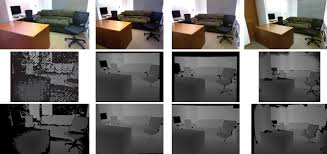

*Figura 2. Ejemplo de la base de datos SUN RGB-D (Song et al., 2015a).*

El repositorio **no incluye** el dataset completo (ver [`data/README.md`](data/README.md)). Estructura esperada:

```
data/SUNRGBD/
├── Train/
│   ├── rgb/            # *.jpg (480x640)
│   ├── depth_input/    # *.npy (metros) o *.png (mm)
│   ├── depth_gt/       # *.npy (metros)
│   └── mask/           # *.png binaria 0/255
└── Validation/
    └── ... (misma estructura)
```

### 7.2 Captura propia con Intel RealSense D430

| Propiedad | Valor |
|---|---|
| Secuencia capturada | 338 fotogramas IR y profundidad |
| Fotogramas integrados tras la validación ICP | 319 |
| Imágenes IR para el ajuste fino de YOLO | 319 |
| Formato de profundidad | Z16 (uint16, milímetros) |
| Resolución de trabajo | 480 × 640 px (relación 4:3, la del sensor IR) |
| Intrínsecos reportados | fx = fy = 380.69; cx = 317.98; cy = 235.06 (ver §15, ítem 6) |

Par IR y profundidad de la secuencia:

| Imagen infrarroja (IR) | Mapa de profundidad (Z16, mm) |
|---|---|
| 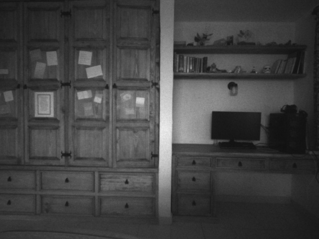 | 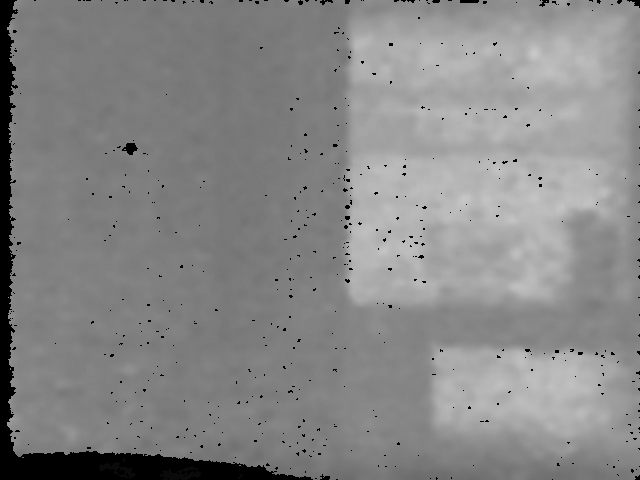 |

*Figura 3. Par IR-Depth de la secuencia de 338 fotogramas. La imagen IR muestra la escena en gris; el mapa de profundidad codifica la distancia en milímetros (Z16).*

---

## 8. Metodología y pipeline

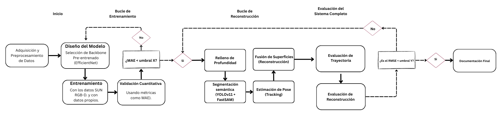

*Figura 1. Diagrama de proceso de la metodología propuesta.*

Etapas del sistema:

1. **Adquisición:** par IR y profundidad de la D430, sin alineación RGB.
2. **Estandarización:** paso a metros, redimensionado a 480 × 640 y máscara de validez.
3. **Completado de profundidad:** Efficient-UNet rellena los huecos del sensor.
4. **Segmentación semántica:** YOLO11x-seg ajustado a IR identifica mobiliario y elementos dinámicos.
5. **Limpieza geométrica:** recorte en Z y filtro estadístico de valores atípicos.
6. **Odometría:** ICP punto-a-plano entre fotogramas consecutivos.
7. **Fusión:** integración TSDF.
8. **Post-procesamiento:** suavizado de Taubin y decimación cuadrática.
9. **Evaluación:** RMSE y *Fitness* de ICP, métricas de completado y segmentación, consistencia geométrica y medición física.

### 8.1 Calibración intrínseca

El reporte indica que los parámetros intrínsecos se extrajeron de los metadatos `.csv` del sensor, en lugar de usar valores genéricos de fábrica:

| Parámetro | Valor |
|---|---|
| Distancia focal `fx` | 380.69 px |
| Distancia focal `fy` | 380.69 px |
| Centro óptico `cx` | 317.98 px |
| Centro óptico `cy` | 235.06 px |

En el código del repositorio estos valores **no se leen de ningún archivo** (ver §15, ítem 6).

### 8.2 Estandarización de datos

| Paso | Detalle |
|---|---|
| Resolución | 480 × 640 px para SUN RGB-D y para la captura propia |
| Canales de entrada | **5 canales**: pseudo-RGB (3 canales), profundidad y máscara |
| Pseudo-RGB | La imagen IR de 1 canal se replica en 3 canales de gris |
| Máscara de validez | Binaria: 1 donde la profundidad es válida, 0 en huecos. La pérdida solo penaliza píxeles con valor 1 |
| Conversión métrica | `uint16 / 1000` → `float32` en metros |
| Valores atípicos | Clamping a **8.0 m** |
| Almacenamiento | `.npy` para los tensores de entrenamiento |
| Captura | Script en Python con `librealsense`, sin filtros del RealSense Viewer ni compresión |

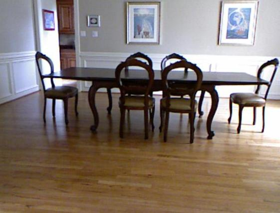

| (a) Imagen RGB de la cámara | (b) Profundidad parcial (entrada) | (c) Profundidad rellenada (salida) |
|---|---|---|
|  | 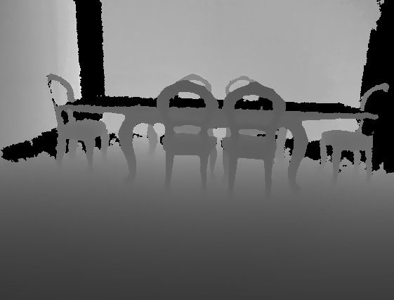 | 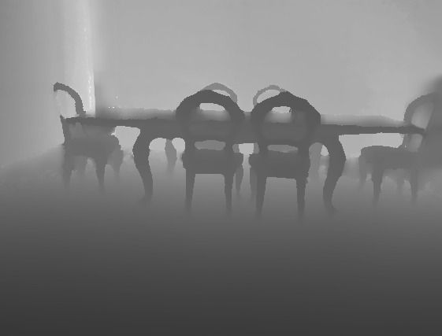 |

*Figura 4. Tres etapas del procesamiento de profundidad (Song et al., 2015a).*

### 8.3 Completado de profundidad con Efficient-UNet

#### 8.3.1 Arquitectura (`src/depth_completion/model_builder.py`)

| Bloque | Detalle |
|---|---|
| Adaptador de entrada | `Conv2D(3, 3×3, same, sin sesgo)`: convierte 5 canales en 3 para el codificador |
| Codificador | **EfficientNetB0** sin la capa de clasificación, pesos de ImageNet, entrenable |
| Saltos (*skip connections*) | `block2b_add` (1/4), `block3b_add` (1/8), `block5c_add` (1/16) y `top_activation` (1/32, cuello de botella) |
| Decodificador | 5 etapas: `UpSampling2D(2×2)`, concatenación con el salto y dos convoluciones 3×3 con ReLU. Canales 256 → 128 → 64 → 32 → 16 |
| Salida | `Conv2D(1, 1×1)` con activación lineal: mapa de profundidad de 1 canal |
| Entrada / salida | (480, 640, 5) → (480, 640, 1) |

#### 8.3.2 Función de pérdida

El reporte describe una **Edge-Aware Loss** con dos términos:

1. **MAE / L1** en metros, solo sobre píxeles válidos (máscara binaria).
2. **Penalización de gradientes espaciales:** diferencias finitas horizontales y verticales entre píxeles adyacentes, para penalizar las transiciones suaves donde la geometría real tiene un borde abrupto.

> **Importante:** la Edge-Aware Loss **no está en el repositorio**. El script de entrenamiento incluido usa MSE (ver §15, ítem 1).

#### 8.3.3 Configuración de entrenamiento

| Hiperparámetro | `train.py` (repositorio) | Versión V2 del reporte |
|---|---|---|
| Optimizador | Adam | Adam |
| Tasa de aprendizaje inicial | 1 × 10⁻⁴ | 1 × 10⁻⁴ |
| Tamaño de lote (*batch*) | 8 | 16 |
| Épocas | 30, con parada temprana (paciencia 5) | 80 |
| Pérdida | `mean_squared_error` | Edge-Aware Loss |
| Métrica de seguimiento | RMSE (Keras) | δ < 1.25 |
| Programador de tasa | `ReduceLROnPlateau`: factor 0.5, paciencia 3 | Igual |
| Pesos guardados | `best_depth_model.keras` (por `val_loss`) | `best_depth_model_v2_edge.pth` (por δ < 1.25) |
| Entrada | 480 × 640 × 5 | 480 × 640 × 5 |

Hardware del entrenamiento reportado: RTX 3080 Ti.

#### 8.3.4 Ejemplos sobre SUN RGB-D

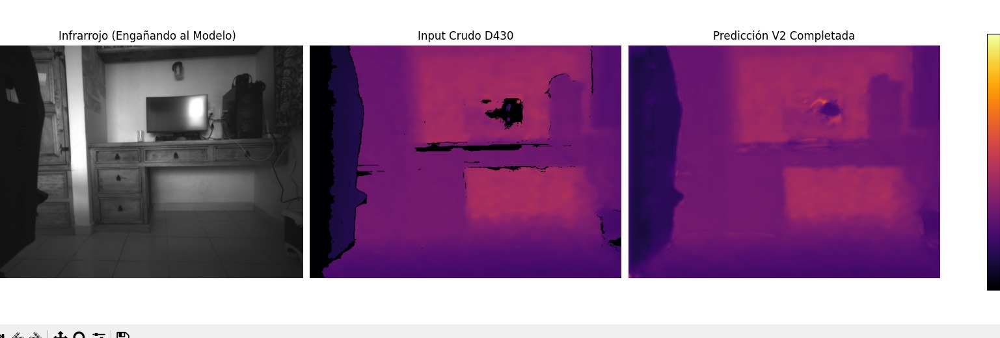

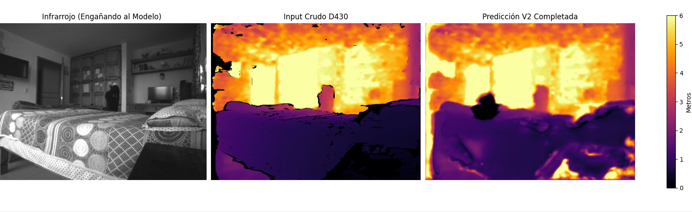

*Figura 6. Rellenos estimados sobre SUN RGB-D (Song et al., 2015a).*

### 8.4 Segmentación semántica con YOLO11x-seg

#### 8.4.1 Problema de dominio óptico

El modelo YOLO11x-seg preentrenado en SUN RGB-D (17 clases de interiores, a color) no detectaba ningún objeto en las capturas IR. La causa es el *gap* de dominio: el sensor IR mide reflectividad, no luz visible, y sus texturas, ruido y sombras son distintos. Hubo que ajustar el modelo en el dominio infrarrojo.

#### 8.4.2 Pseudo-etiquetas con FastSAM

No se anotó manualmente ningún fotograma. El script `src/segmentation/generate_pseudolabels.py` genera las etiquetas así:

1. **Detección inicial:** FastSAM (`FastSAM-s.pt`) sobre la imagen IR convertida a 3 canales.
2. **Filtro de profundidad:** se descarta cada máscara cuya profundidad media supere el **percentil 80** de la profundidad válida del fotograma. Así se separan las superficies lejanas (paredes y fondo) del mobiliario cercano.
3. **Filtro de tamaño:** se descartan máscaras con menos de **500 px** y máscaras que ocupen más del **70 %** del fotograma.
4. **Morfología:** cierre con elipse de 3×3 y recorte con la máscara de validez.
5. **Formato YOLO-seg:** contornos externos como polígonos normalizados, clase única `0 = object`.

Parámetros: `conf = 0.3`, `min_area = 500`, `depth_percentile = 80`, `depth_scale = 0.001`, `max_depth = 8.0` m.

**Ablación del percentil** (`experiments/ablacion/`), sobre las 318 imágenes capturadas:

| Percentil | Razón media de máscara | Mínimo | Máximo | Interpretación del reporte |
|---|---|---|---|---|
| 70 | 91.15 % | 0.52 % | 98.02 % | Demasiado permisivo: incluye paredes traseras, cuadros y estanterías |
| **80 (elegido)** | **69.88 %** | 0.00 % | 97.95 % | Balance: elimina el fondo y conserva el mobiliario |
| 90 | 61.53 % | 0.00 % | 97.95 % | Demasiado restrictivo: descarta mobiliario real y deja máscaras vacías |

Los valores coinciden con `experiments/ablacion/ablacion_p*/segmentation_summary.txt`. El percentil es un parámetro **fijo** para todas las escenas (ver §11).

#### 8.4.3 Ajuste fino en infrarrojo

- **Modelo base:** `yolo11x-sunrgbd-seg.pt` (preentrenado en SUN RGB-D; el comentario de `configs/yolo_ir_config.yaml` indica mAP50 de 0.919). **Este archivo no está en el repositorio**; si falta, el código usa `yolo11x-seg.pt` como respaldo.
- **Justificación de la tasa de aprendizaje:** según la transferibilidad de características (Yosinski et al., 2014), las capas iniciales son generales y las finales se especializan. Por eso se usó una tasa 20 veces menor que la original (`lr0 = 0.0005` frente a `0.01`).

| Grupo | Parámetro | Valor | Motivo |
|---|---|---|---|
| Optimización | `optimizer` | AdamW | Convergencia estable con pocos datos |
| | `lr0` / `lrf` | 5 × 10⁻⁴ / 1 × 10⁻³ | Ajuste fino conservador |
| | `momentum` / `weight_decay` | 0.937 / 5 × 10⁻⁴ | Valores por defecto de Ultralytics |
| | `warmup_epochs` | 3 | — |
| | `cos_lr` | `true` | Decaimiento coseno |
| | `close_mosaic` | 10 | Desactiva el mosaico en las últimas épocas |
| | `patience` | 30 | Parada temprana |
| Entrenamiento | `epochs` / `batch` / `imgsz` | 60 / 16 / 640 | — |
| | `amp` / `seed` / `deterministic` | `true` / 0 / `true` | Reproducibilidad |
| Aumentos para IR | `hsv_h` / `hsv_s` | 0.0 / 0.0 | IR no tiene información de color |
| | `hsv_v` | 0.2 | Robustez ante cambios de intensidad del emisor láser |
| | `degrees` / `translate` / `scale` | 5.0 / 0.1 / 0.25 | Aumentos geométricos moderados |
| | `fliplr` | 0.5 | Volteo horizontal |
| | `mosaic` | 0.5 | Reducido por el ruido de las pseudo-etiquetas |
| | `mixup` / `copy_paste` | 0.0 / 0.0 | Desactivados por el mismo motivo |

El registro real (`experiments/curva_aprendizaje/args.yaml`) también muestra `auto_augment: randaugment` y `erasing: 0.4`, que son valores por defecto de Ultralytics y no aparecen en el reporte.

#### 8.4.4 Resultados de la segmentación

**Métricas globales** (Tabla 7 del reporte):

| Métrica | Resultado |
|---|---|
| Box mAP50 | 0.9000 (90.00 %) |
| Box mAP50-95 | 0.7720 (77.20 %) |
| Mask mAP50 | 0.8782 (87.82 %) |
| Mask mAP50-95 | 0.6525 (65.25 %) |

**Desglose por clase** (Tabla 8 del reporte, AP de máscara):

| Clase | AP50 | AP (mAP50-95) |
|---|---|---|
| Suelo (*floor*) | 0.9467 (94.67 %) | 0.7227 (72.27 %) |
| Mobiliario (*furniture*) | 0.8959 (89.59 %) | 0.6517 (65.17 %) |
| Pared (*wall*) | 0.7919 (79.19 %) | 0.5830 (58.30 %) |

Interpretación según el reporte: el suelo, al ser una superficie continua y casi perpendicular al eje de captura, da un retorno IR estable; el mobiliario permite aislar objetos volumétricos; las paredes, lisas y lejanas, tienen pocos bordes texturizados en IR.

> **Nota de validación.** Estas métricas se calcularon sobre las **mismas pseudo-etiquetas** usadas para entrenar. Miden consistencia interna y no son comparables con mAPs contra anotación humana. El sesgo de las etiquetas erróneas no está cuantificado.

**Registro de entrenamiento** (`experiments/curva_aprendizaje/results.csv`, época 60):

| Métrica | Valor |
|---|---|
| Box mAP50 | 0.8898 |
| Box mAP50-95 | 0.7333 |
| Mask mAP50 | **0.7810** |
| Mask mAP50-95 | **0.4848** |
| Pérdida de segmentación (entrenamiento) | 1.605 (inicial ≈ 4.45) |
| Pérdida de clasificación (entrenamiento) | 0.584 (inicial ≈ 2.46) |
| Tiempo acumulado | 778 s (≈ 13 min) |
| Tasa de aprendizaje final | 8.4 × 10⁻⁷ |

Los valores de máscara del CSV **no coinciden** con la Tabla 7 del reporte (ver §15, ítem 5).

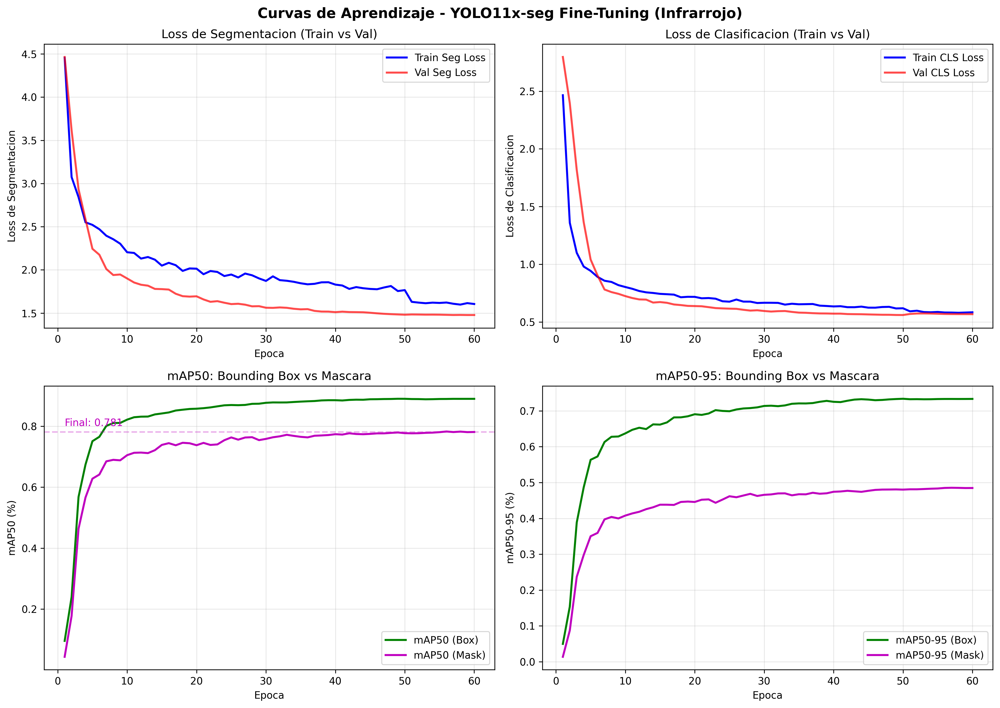

*Curvas de entrenamiento de 60 épocas: pérdidas de segmentación y clasificación, y mAP50 y mAP50-95 de caja y máscara.*

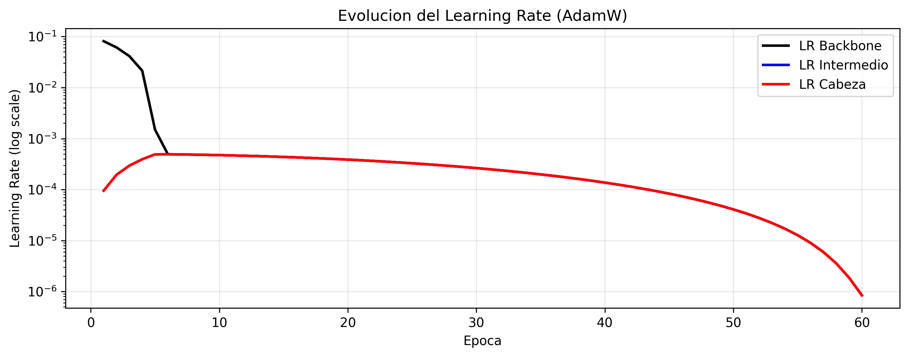

*Evolución de la tasa de aprendizaje (AdamW con decaimiento coseno).*

Ejemplos de segmentación en infrarrojo:

| Ejemplo 1 | Ejemplo 2 |
|---|---|
| 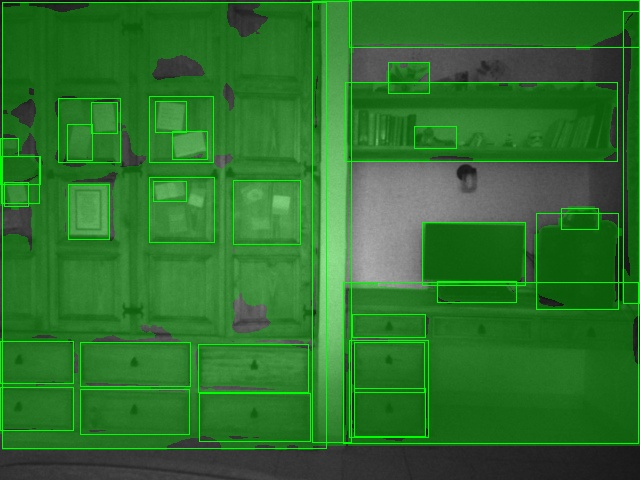 | 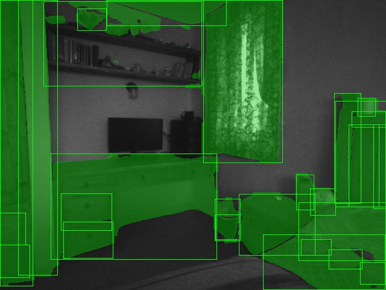 |

*Figura 7. Ejemplos de segmentación semántica con YOLO11x-seg sobre imágenes infrarrojas.*

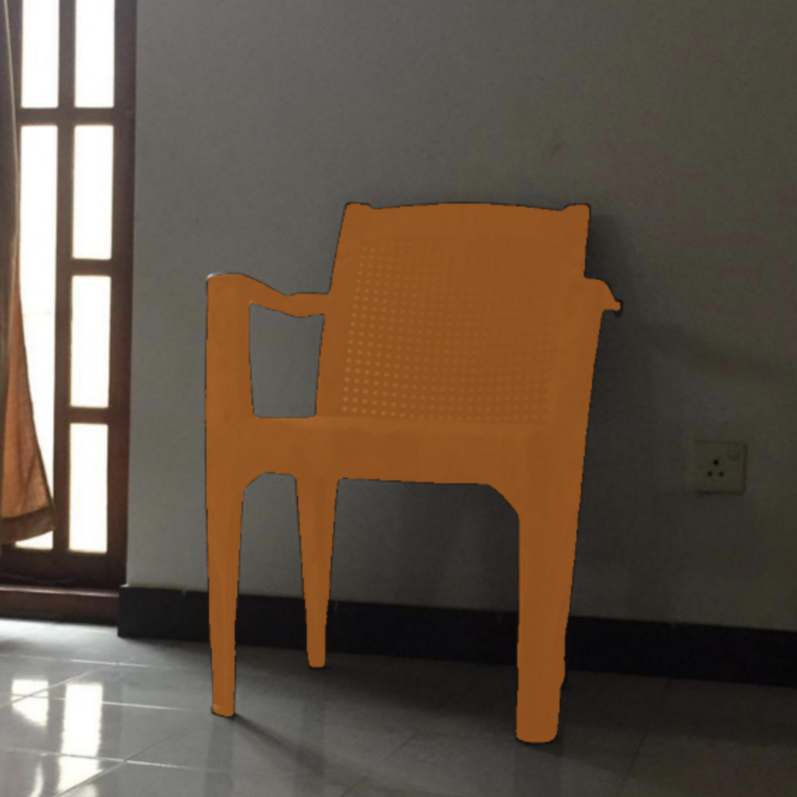

*Figura 5. Ejemplo de segmentación semántica con YOLO sobre una silla.*

### 8.5 Limpieza geométrica

| Paso | Parámetro |
|---|---|
| Recorte en Z | [0.3, 2.8] m |
| Filtro estadístico de valores atípicos | `nb_neighbors = 20`, `std_ratio = 1.0` |
| Recorte simétrico desde la mediana | ±2.0 m (`experiments/reconstruccion/save_final_cleaned_cloud.py`) |

El filtro estadístico calcula la distancia media de cada punto a sus 20 vecinos más cercanos y elimina los que superan la media en más de 1 desviación estándar.

### 8.6 Odometría: ICP punto-a-plano

Implementado en `experiments/reconstruccion/run_final_reconstruction.py`:

| Paso | Detalle |
|---|---|
| Profundidad | Clamping a [0, 8.0] m, escala `depth_scale = 0.001` |
| Nube por fotograma | `create_from_rgbd_image`, submuestreo por vóxel de 0.02 m y normales estimadas |
| Inicialización | `compute_rgbd_odometry` con `RGBDOdometryJacobianFromHybridTerm` |
| Refinamiento | `registration_icp` con `TransformationEstimationPointToPlane`, `max_correspondence_distance = 0.08` m, `max_iteration = 60` |
| Composición de pose | `pose = prev_pose @ inv(T_icp)` |
| Métricas por par | `fitness` y `inlier_rmse` |

`src/reconstruction/tools/run_reconstruction_v2.py` usa un ICP más estricto (`distance = 0.04`, `iter = 80`) y rechaza fotogramas con `fitness < 0.4`. Ver §15, ítem 10.

### 8.7 Fusión volumétrica TSDF

| Parámetro | Valor |
|---|---|
| Tipo de volumen | `ScalableTSDFVolume` (Open3D) |
| Tamaño de vóxel | **8 mm** (`--voxel-length 0.008`) |
| Banda de truncamiento `sdf_trunc` | **3 cm** (`--sdf-trunc 0.03`) |
| Color | RGB8: la imagen IR se replica a BGR |
| Extracción de malla | `extract_triangle_mesh` (Marching Cubes) |
| Salidas | `reconstruction_mesh.ply`, `reconstruction_cloud.ply`, `evaluation.txt` |

### 8.8 Post-procesamiento de la malla

1. **Suavizado de Taubin:** elimina irregularidades sin contraer el volumen.
2. **Decimación cuadrática:** colapsa triángulos pequeños en zonas planas. Los scripts usan objetivos de 200 K, 300 K o 500 K triángulos. La malla final del reporte tiene **150,067 triángulos** (§9.5).
3. **Exportación:** `.ply`, compatible con SketchUp, Blender y Unity según el reporte.

### 8.9 Cronograma del proyecto

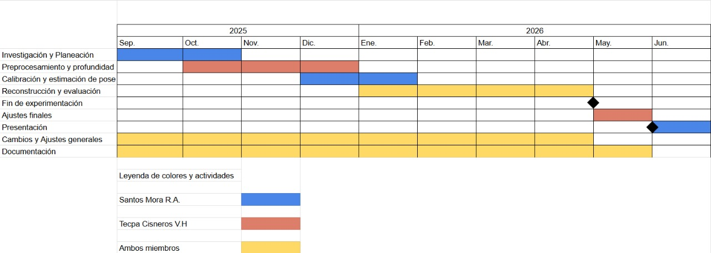

*Figura 10. Cronograma del proyecto (septiembre de 2025 a junio de 2026), con responsabilidades por integrante.*

| Fase | Actividades |
|---|---|
| 1. Investigación y planificación | Revisión bibliográfica de métodos RGB-D; técnicas de reconstrucción 3D; selección de herramientas y datasets; planificación del modelo experimental |
| 2. Preprocesamiento y profundidad | Adquisición de imágenes RGB-D e IR con la D430; limpieza y alineación de datos; generación y normalización de mapas de profundidad; implementación del completado |
| 3. Calibración, pose e identificación | Calibración intrínseca y extrínseca; estimación de pose (PnP y ajuste en haz); emparejamiento de características; validación de la pose |
| 4. Reconstrucción y evaluación | Integración de vistas con ICP punto-a-plano; nubes y mallas con TSDF; comparación con datos de referencia; refinamiento del modelo |
| 5. Documentación final | Informe técnico; resultados y conclusiones; revisión y presentación |

---

## 9. Resultados

La integración completa se evaluó sobre **338 fotogramas** de una escena interior. **319** se integraron tras la validación ICP. Cada componente también se evaluó por separado.

### 9.1 Clasificación de métricas

| Métrica | Componente | Tipo de validación | Referencia |
|---|---|---|---|
| MAE, RMSE, δ < 1.25 | Efficient-UNet | Externa | Mapas de profundidad reales (SUN RGB-D y captura propia) |
| Box mAP50, Mask mAP50 | YOLO11x-seg | Consistencia interna | Pseudo-etiquetas de FastSAM (mismo conjunto de entrenamiento) |
| ICP *Fitness*, ICP RMSE | Odometría | Externa | Correspondencias entre fotogramas consecutivos |
| Ortogonalidad, paralelismo, escala | Malla final | Indirecta | Propiedades arquitectónicas y medición con cinta métrica |

### 9.2 Completado de profundidad

Se compararon tres modelos sobre un conjunto de validación independiente de **1,399 imágenes**:

| Modelo | Descripción |
|---|---|
| ResNet18 (base) | Codificador-decodificador estándar; punto de partida |
| Efficient-UNet V1 | EfficientNet-B0 como codificador, pérdida estándar (L1/MSE) |
| Efficient-UNet V2 (propuesto) | EfficientNet-B0 con Edge-Aware Loss |

**Evaluación global** (área válida completa):

| Métrica | ResNet18 (base) | Efficient-UNet V1 | **Efficient-UNet V2** |
|---|---|---|---|
| δ < 1.25 | 93.57 % | 98.14 % | **98.33 %** |
| δ < 1.25² | 97.76 % | 99.29 % | **99.31 %** |
| δ < 1.25³ | 99.11 % | **99.58 %** | 99.56 % |
| MAE | 0.1797 m | 0.0716 m | **0.0664 m** |
| RMSE | 0.3777 m | **0.2158 m** | 0.2227 m |

**Evaluación en zonas ciegas** (solo huecos; 85,223,296 píxeles para V2):

| Métrica | ResNet18 (base) | Efficient-UNet V1 | **Efficient-UNet V2** |
|---|---|---|---|
| δ < 1.25 | 76.91 % | 91.47 % | **92.47 %** |
| δ < 1.25² | 90.81 % | 96.60 % | **96.73 %** |
| δ < 1.25³ | 95.95 % | **97.97 %** | 97.86 % |
| MAE | 0.4316 m | 0.2256 m | **0.2179 m** |
| RMSE | 0.7466 m | **0.4954 m** | 0.5080 m |

**Lectura según el reporte:** ResNet18 tuvo un MAE de casi 18 cm en la escena global y de 43 cm en huecos, lo que daría una trayectoria errática en la odometría. V2 mejora el MAE y la precisión δ respecto a V1, aunque su RMSE es ligeramente mayor, porque prioriza la nitidez de los bordes.

**Registro de entrenamiento.** El entrenamiento de Efficient-UNet no generó registros por época (se ejecutó en un entorno interactivo). Las métricas finales sí provienen del conjunto de validación independiente.

### 9.3 Segmentación semántica

Ver §8.4.4: métricas globales, desglose por clase, curvas de entrenamiento y nota de validación.

### 9.4 Odometría visual (ICP)

Promedios sobre los **319 fotogramas integrados** (tabla del reporte):

| Métrica | Resultado |
|---|---|
| Proporción de profundidad válida | 92.35 % |
| Nivel de ajuste (*ICP Fitness*) | 95.54 % |
| Error cuadrático medio de alineación (*ICP RMSE*) | **0.0252 m (2.52 cm)** |

Más de 9 de cada 10 puntos encontraron correspondencia entre fotogramas consecutivos. El RMSE mide el error **local** entre pares, no el error acumulado de la trayectoria, que no se evaluó contra una referencia externa.

### 9.5 Malla volumétrica: complejidad y tamaño

| Métrica | Malla TSDF original | Malla decimada final | Reducción |
|---|---|---|---|
| Vértices | 11,409,829 | 69,532 | 99.4 % |
| Triángulos | 14,148,189 | 150,067 | 98.9 % |
| Tamaño `.ply` | 730.35 MB | 5.24 MB | 99.3 % |

La decimación conserva el detalle en bordes y esquinas, y colapsa triángulos redundantes en paredes y suelo.

| Vista 1 | Vista 2 | Vista 3 |
|---|---|---|
| 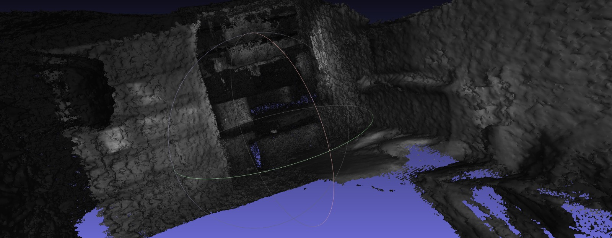 | 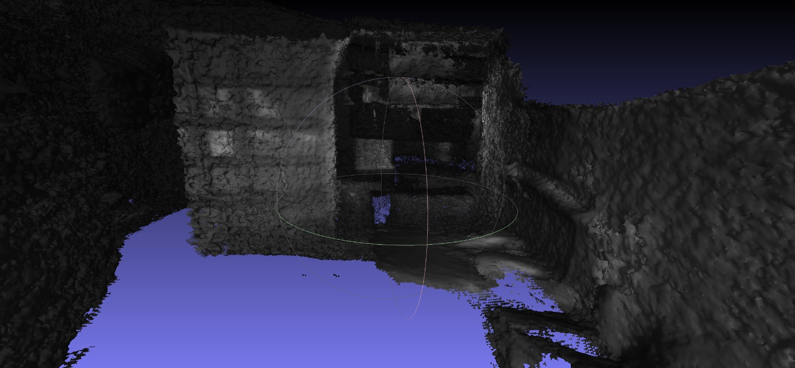 | 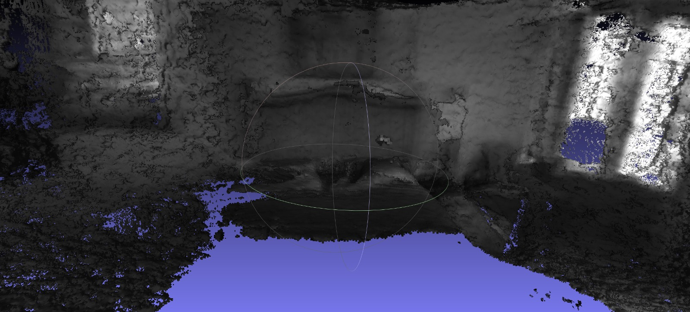 |

*Figura 8. Modelo 3D final. La integración TSDF de 319 fotogramas produce superficies continuas. Las tres imágenes son vistas en perspectiva de la malla. El reporte describe la vista 1 como lateral, la vista 2 como lateral y la vista 3 como superior; en las imágenes, la vista 3 se parece más a una perspectiva oblicua (ver §15, ítem 17).*

En las vistas se observan superficies continuas en paredes, mobiliario y piso. En las esquinas aparecen desalineaciones leves, consistentes con la acumulación de error de rotación.

### 9.6 Consistencia geométrica global

Como *proxy* del *drift* acumulado, se extrajeron planos dominantes de la malla con RANSAC y se midieron los ángulos entre ellos. Esta estrategia sigue a Iyer et al. (2018) y Fontan et al. (2024).

| Métrica | Medido | Esperado | Desviación |
|---|---|---|---|
| Pared 0 – Pared 1 (adyacentes) | 79.98° | 90° | −10.02° |
| Pared 0 – Pared 3 (adyacentes) | 83.31° | 90° | −6.69° |
| Pared 1 – Pared 2 (adyacentes) | 60.59° | 90° | −29.41° |
| Pared 2 – Pared 3 (adyacentes) | 61.87° | 90° | −28.13° |
| Pared 0 – Pared 2 (opuestas, paralelismo) | 21.58° | 0° | +21.58° |
| Pared 1 – Pared 3 (opuestas, paralelismo) | 18.33° | 0° | +18.33° |
| Pared 0 – Suelo | 88.17° | 90° | −1.83° |
| Pared 1 – Suelo | 77.07° | 90° | −12.93° |
| Pared 2 – Suelo | 87.38° | 90° | −2.62° |
| Pared 3 – Suelo | 84.84° | 90° | −5.16° |
| Distancia Pared 0 – Pared 2 | 0.036 m | Variable | — |
| Distancia Pared 1 – Pared 3 | 2.293 m | Variable | — |

**Lectura según el reporte:** las paredes adyacentes se desvían entre 6.69° y 29.41° de la ortogonalidad, y las opuestas no son paralelas (18.33° y 21.58°). Tres de las cuatro paredes son casi perpendiculares al suelo (menos de 6°); la Pared 1 se inclina 12.93°.

| Malla final | Nube etiquetada |
|---|---|
| 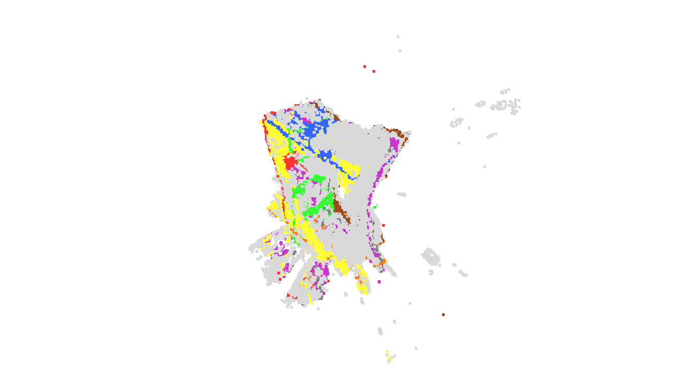 | 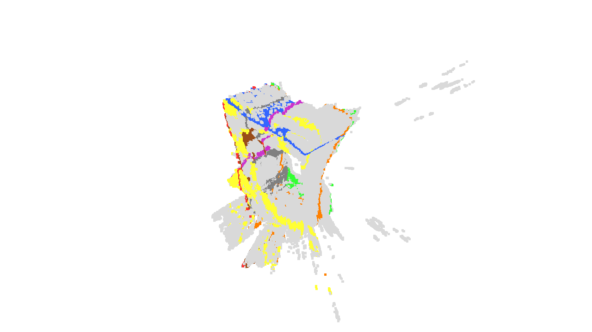 |

*Figura 9. Planos dominantes detectados con RANSAC. Cada color es un plano; los puntos grises son geometría no plana (objetos y ruido).*

### 9.7 Medición física de la habitación

| Dimensión | Real (cinta métrica) | Modelo 3D (post-procesado) | Error |
|---|---|---|---|
| Ancho (X) | 3.810 m | 4.000 m | +5.0 % (19 cm) |
| Largo (Y) | 4.978 m | 3.973 m | −20.2 % (100.5 cm) |
| Alto (Z) | 2.527 m | 2.500 m | −1.1 % (2.7 cm) |

**Sin post-procesamiento**, la nube integrada se "estiraba" verticalmente más de 14 m (+458.5 %) por puntos atípicos en techo y suelo. El recorte en Z y el filtro estadístico corrigen ese efecto.

- **Z:** el error de −1.1 % muestra que el recorte elimina el ruido de techo y suelo.
- **X:** el error de +5.0 % es comparable con sensores RGB-D de gama media.
- **Y:** el error de −20.2 % es el mayor. Según el reporte, el *drift* se acumula en la dirección del movimiento dominante, que en esta secuencia corresponde al eje Y.

---

## 10. Conclusiones

- La integración de completado de profundidad, segmentación semántica y odometría ICP sobre infrarrojo puro es **funcional** en el entorno evaluado. La malla de 14 millones de triángulos se reduce a 150 K triángulos y 5.24 MB.
- El RMSE local de ICP (2.52 cm) con *Fitness* de 95.54 % es **competitivo** para un sensor de bajo costo, pero no cumple el objetivo de 2 cm.
- La **trayectoria global** queda **parcialmente cumplida**: el *drift* distorsiona la estructura (ángulos de hasta 29.41° y −20.2 % en el eje longitudinal).
- Operar en infrarrojo eliminó la desalineación óptica RGB-D. Según el reporte, la Edge-Aware Loss mejoró la nitidez de bordes frente a L1.
- El ajuste fino con pseudo-etiquetas adaptó YOLO al dominio IR sin anotación manual, aunque sin validación contra anotación humana.

**Distinción de métricas.** Tienen referencia real el RMSE de ICP, el *Fitness* y las métricas de completado. El mAP de YOLO es de consistencia interna.

---

## 11. Limitaciones

1. **Deriva acumulativa (*drift*).** El RMSE de 2.52 cm es local entre pares consecutivos. Las desviaciones angulares (6.69°–29.41°) muestran que el *drift* distorsionó la estructura. No hay cierre de bucle ni ajuste de haz global.
2. **Dependencia del post-procesamiento para la escala.** El recorte de ejes y el filtro estadístico son un paliativo. Sin ellos, la nube tiene un estiramiento vertical de +458.5 %. El sistema no garantiza la escala global por sí solo, y el post-procesamiento requiere conocer las dimensiones aproximadas del entorno.
3. **Tamaño del conjunto de transferencia de dominio.** El ajuste fino usó 319 fotogramas, un número pequeño para garantizar generalización. No se evaluó en habitaciones con otra distribución de profundidad o iluminación.
4. **Sin líneas base comparativas.** No se evaluó el sistema sin completado de profundidad: los mapas crudos tienen huecos grandes que impiden un ICP robusto. La D430 no tiene canal RGB, así que tampoco hay comparación con un *pipeline* RGB-D.
5. **Pseudo-etiquetas sin validación manual.** El sesgo de las etiquetas erróneas no está cuantificado. El mAP reportado es de consistencia interna.
6. **Superficies problemáticas.** El sensor IR falla en superficies muy reflectantes (metal pulido, espejos) y transparentes (vidrio). No se evaluaron sistemáticamente.
7. **Oclusión severa.** La evaluación se hizo con visibilidad razonable. No se caracterizó el comportamiento con oclusiones agresivas.
8. **Dependencia de GPU.** El pipeline completo necesita una GPU de gama alta para tiempos aceptables.
9. **Percentil fijo en el filtro de FastSAM.** El percentil 80 no escala con el tamaño del espacio: en un pasillo de 2 m podría eliminar mobiliario real, y en una sala de 10 m podría dejar pasar paredes lejanas.

---

## 12. Trabajo futuro

- **Trayectoria de referencia externa** (estación total o captura de movimiento) para medir el ATE (*Absolute Trajectory Error*) de forma directa (Sturm et al., 2012; Handa et al., 2014).
- **Cierre de bucle y ajuste de haz global** para contener el *drift*.
- **Umbral adaptativo** en el filtro de FastSAM, basado en la mediana de profundidad del fotograma, el rango intercuartílico o un percentil relativo a la profundidad máxima del sensor.
- **Validación manual** de una muestra de las pseudo-etiquetas, para cuantificar su sesgo.
- **Registro por época** del entrenamiento de Efficient-UNet (CSV o TensorBoard), para analizar la convergencia y el efecto de la Edge-Aware Loss frente a L1.
- **Líneas base:** sin completado de profundidad y, si hay hardware, con un *pipeline* RGB-D.
- **Pruebas en varios entornos:** espejos, vidrio, superficies de baja textura, iluminación variable y oclusión severa.
- **Reducir la dependencia de GPU** para ejecutar en hardware de consumo.

---

## 13. Instalación

Requisitos: Windows 10/11 o Linux, Python 3.12 y Git. Para entrenar y reconstruir se recomienda una GPU NVIDIA con CUDA.

### 13.1 Clonar

```powershell
git clone https://github.com/PHDRENIS/Reconstruccion_3D.git
cd Reconstruccion_3D
```

### 13.2 Crear el entorno

**Opción A: conda** (`environment.yml`, entorno `tt` con Python 3.12 y `requirements.txt`):

```powershell
conda env create -f environment.yml
conda activate tt
```

**Opción B: venv**

```powershell
python -m venv .venv
.\.venv\Scripts\Activate.ps1
pip install --upgrade pip
pip install -r requirements.txt
```

> **TensorFlow en Windows:** desde TensorFlow 2.11, la versión nativa de Windows solo usa CPU. Para entrenar el completado de profundidad con GPU, usa WSL2 con Ubuntu.

### 13.3 Pesos de modelos

Los pesos no se versionan: `.gitignore` excluye `*.pt`, `*.pth` y `*.keras`. El repositorio tampoco incluye la carpeta `models/`.

| Modelo | Origen | Cómo obtenerlo |
|---|---|---|
| `yolo11x-sunrgbd-seg.pt` | Preentrenamiento sobre SUN RGB-D | No incluido. Solicitar al autor o usar el respaldo `yolo11x-seg.pt` |
| `yolo11x-seg.pt` | Ultralytics | Descarga automática |
| `FastSAM-s.pt` | Ultralytics | Descarga automática |
| `best_depth_model.keras` | `src/depth_completion/train.py` | Entrenar |
| `outputs/yolo_ir_finetuned.pt` | `src/segmentation/main.py` | Entrenar |

### 13.4 Datos

Seguir [`data/README.md`](data/README.md) para descargar SUN RGB-D (<http://rgbd.cs.princeton.edu/>) y colocarlo en `data/SUNRGBD/`.

---

## 14. Uso

Ejecuta los comandos desde la raíz del repositorio.

### 14.1 Preprocesamiento

Según [`data/README.md`](data/README.md):

```powershell
python src/preprocessing/png_to_npy.py        # PNG (mm) -> NPY (m)
python src/preprocessing/Resizing_depth.py    # redimensionado a 480x640
python src/preprocessing/Resizing_masks.py
python src/preprocessing/quitar_abs.py        # corrige sufijos _abs
python src/preprocessing/to_binary.py         # máscaras binarias 0/255
```

Revisa las rutas dentro de cada script antes de ejecutarlo.

### 14.2 Completado de profundidad (TensorFlow)

```powershell
python src/depth_completion/train.py
```

Usa rutas relativas a `data/SUNRGBD/` y genera `best_depth_model.keras`. El reporte menciona `python -m src.depth_completion.train`; ese comando no funciona porque el script importa `data_loader` y `model_builder` como módulos de nivel superior. Ejecutar el archivo directamente sí funciona.

### 14.3 Segmentación YOLO IR

```powershell
# Pipeline completo: pseudo-etiquetas + ajuste fino
python src/segmentation/main.py --config configs/yolo_ir_config.yaml

# Solo pseudo-etiquetas
python src/segmentation/main.py --config configs/yolo_ir_config.yaml --pseudolabels-only

# Solo entrenamiento (requiere pseudo-etiquetas previas)
python src/segmentation/main.py --config configs/yolo_ir_config.yaml --train-only

# Solo evaluación de un modelo existente
python src/segmentation/main.py --config configs/yolo_ir_config.yaml --eval-only
```

Salidas: `outputs/pseudolabels/*.txt`, `outputs/yolo_ir_finetuned.pt` y `runs/segment/yolo_ir_finetune/`. Antes de ejecutar, revisa en `configs/yolo_ir_config.yaml` los campos `model.base` y `paths`.

### 14.4 Reconstrucción 3D

Script de referencia del reporte: `experiments/reconstruccion/run_final_reconstruction.py`.

```powershell
python experiments/reconstruccion/run_final_reconstruction.py `
  --ir-dir "C:\ruta\a\imagenes_ir" `
  --depth-dir "C:\ruta\a\mapas_profundidad" `
  --output-dir "outputs\reconstruccion" `
  --yolo-model "outputs\yolo_ir_finetuned.pt" `
  --depth-scale 0.001 `
  --voxel-length 0.008 `
  --sdf-trunc 0.03 `
  --yolo-conf 0.3
```

- Los archivos deben llamarse `yolo_data_*.jpg` (IR) y `yolo_data_*.png` (profundidad); el script los empareja por nombre.
- Salidas: `reconstruction_mesh.ply`, `reconstruction_cloud.ply` y `evaluation.txt` (frames, detecciones promedio de YOLO, `avg_valid_depth`, `icp_fitness`, `icp_rmse`, vértices y triángulos).

> **Importante:** en esta versión del script, la máscara de YOLO se calcula pero **no se aplica** a la odometría ni a la integración, y la profundidad se toma de `--depth-dir` sin pasar por el completado. El reporte describe ambas etapas. Ver §15, ítems 7 y 8.

Otras herramientas están en `src/reconstruction/tools/`, por ejemplo `run_reconstruction_v2.py` (ICP estricto, vóxel de 5 mm), `reconstruction_max_quality.py`, `clean_room_mesh.py` y `mls_poisson_clean.py`. Revisa sus argumentos con `--help`.

### 14.5 Inferencia de ejemplo

`experiments/inferencia/inferencia.py` aplica `yolo11s-sunrgbd-seg.pt` a las imágenes de `Validation/rgb` (RGB, no IR) y guarda los resultados en `imagenes_inferencia/`. Sirve para ilustrar la salida del modelo sobre SUN RGB-D, no el desempeño sobre infrarrojo. Las rutas en el script son relativas y deben ajustarse.

### 14.6 Scripts de Linux / HPC

Los archivos `scripts/*.sh` son wrappers de bash. En Windows usa directamente los comandos de arriba.

| Script | Contenido |
|---|---|
| `scripts/preprocessing.sh` | Preprocesamiento |
| `scripts/train_yolo_ir.sh` | Ajuste fino de YOLO IR (`src/segmentation/main.py`) |
| `scripts/run_fv2.sh` | Pipeline FV2 |
| `scripts/reconstruction.sh` | Ejecuta `src/reconstruction/tools/run_final_reconstruction.py` y `reconstruction_max_quality.py` sin argumentos. Revisa sus rutas antes de usarlo |

---

## 15. Discrepancias entre el reporte y el repositorio

Estas diferencias se encontraron al revisar el código y los archivos. Se documentan para facilitar la reproducción.

| # | Tema | Reporte (`main.tex`) | Repositorio |
|---|---|---|---|
| 1 | Edge-Aware Loss | Pérdida personalizada de la V2 | No implementada. `train.py` usa MSE |
| 2 | Entrenamiento del completado | 80 épocas, batch 16, `best_depth_model_v2_edge.pth` | `train.py`: 30 épocas, batch 8, `best_depth_model.keras` |
| 3 | Framework del completado | PyTorch | TensorFlow/Keras (`src/depth_completion/`) |
| 4 | Decodificador | `nn.Upsample` bilineal | `UpSampling2D` de Keras (vecino más cercano por defecto) |
| 5 | Métricas finales de YOLO | Tabla 7: mask mAP50 = 0.8782; mask mAP50-95 = 0.6525 | `results.csv`, época 60: mask mAP50 = 0.7810; mask mAP50-95 = 0.4848. La gráfica coincide con el CSV. El origen de la Tabla 7 no está en el repositorio |
| 6 | Intrínsecos | Leídos de los metadatos `.csv` (fx = 380.69) | `run_final_reconstruction.py` usa `PrimeSenseDefault`; `reconstruction_max_quality.py` aproxima `fx = w × 1.05`. No hay código que lea los metadatos |
| 7 | Máscara de YOLO en la odometría | Se envía a la odometría para ignorar objetos dinámicos | Se calcula pero no se usa en `run_final_reconstruction.py` |
| 8 | Completado en la reconstrucción | El pipeline completa la profundidad antes de la odometría | `run_final_reconstruction.py` toma la profundidad de `--depth-dir` sin completarla |
| 9 | Tamaño de vóxel | 8 mm | 8 mm en `run_final_reconstruction.py`; 5 mm en `run_reconstruction_v2.py` |
| 10 | Umbral de *fitness* | Rechazo de fotogramas con fitness bajo | `run_reconstruction_v2.py` rechaza `fitness < 0.4`; `run_final_reconstruction.py` solo registra el valor |
| 11 | Objetivo de decimación | ≈ 300,000 polígonos (Cap. 2) y 150,067 triángulos finales (Cap. 5) | Los scripts usan 200 K, 300 K o 500 K |
| 12 | Imágenes de la pseudo-etiquetación | 319 en la mayoría de las secciones | 318 en el texto de la ablación |
| 13 | Tiempo de inferencia de YOLO | 3.6 ms por imagen en GPU A100 | El equipo de desarrollo fue una RTX 3080 Ti |
| 14 | Memoria del entrenamiento | 18–20 GB en RTX 3080 Ti | La RTX 3080 Ti tiene 12 GB de VRAM |
| 15 | Imágenes de SUN RGB-D | "Más de 10,000" (Cap. 2) y "más de 7,000" (Cap. 4) | 7,245 de entrenamiento y 319 de validación (Cap. 4) |
| 16 | Precio del sensor | Resumen: MXN (2,000–3,000) | Tabla 4: USD (200–300) |
| 17 | Figura 8 | Vista 2 "lateral" y vista 3 "superior" | Las tres imágenes son perspectivas oblicuas; la vista 3 no parece una vista cenital |
| 18 | Figura de RANSAC | Titulada "Malla Poisson" | Muestra planos sobre la nube/malla, no una malla Poisson |
| 19 | Preentrenamiento YOLO | Citado en la metodología | `yolo11x-sunrgbd-seg.pt` no está en el repositorio |
| 20 | Script de captura | `librealsense` en la metodología | No está en el repositorio |
| 21 | Rutas de figuras en `main.tex` | `Reconstruccion 2.jpeg` y `Reconstrucción 3.jpeg` | Los archivos son `reconstruccion_2.jpeg` y `reconstruccion_3.jpeg`; el `.tex` no compila sin corregirlas |
| 22 | Inferencia de ejemplo | — | `inferencia.py` usa un modelo SUN RGB-D sobre imágenes RGB, no IR |

Para reproducir fielmente los resultados del reporte:

1. Recuperar la implementación de la Edge-Aware Loss y el checkpoint `best_depth_model_v2_edge.pth`.
2. Confirmar qué script y parámetros produjeron la malla final, incluido el origen de los intrínsecos.
3. Aplicar la máscara de YOLO y el completado de profundidad en el script de reconstrucción si se quiere reproducir el pipeline descrito.

---

## 16. Estructura del repositorio

```
Reconstruccion_3D/
├── .github/workflows/ci.yml         # CI: ruff (no bloqueante) y py_compile
├── configs/
│   ├── yolo_ir_config.yaml          # Ajuste fino de YOLO IR (hiperparámetros y rutas)
│   ├── yolo_ir_dataset.yaml         # Dataset YOLO de una clase (object)
│   ├── sunrgbd.yaml
│   ├── fv2_config.yaml, fv2_train_config.yaml
│   └── legacy/                      # Configuraciones de F Vision v1 (archivadas)
├── data/
│   ├── README.md                    # Cómo obtener SUN RGB-D
│   └── samples/                     # 3 imágenes de ejemplo
├── docs/
│   ├── reporte/                     # PDFs del trabajo terminal
│   ├── reporte_final/               # Fuente LaTeX (main.tex), referencias.bib
│   │   └── Figuras/                 # Figuras del reporte
│   ├── diapositivas/                # Presentación
│   ├── ejemplos/                    # Ejemplos IR y profundidad
│   └── bitacora/                    # Bitácora del trabajo terminal
├── experiments/
│   ├── ablacion/                    # Ablación del percentil (p70, p80, p90)
│   ├── curva_aprendizaje/           # results.csv, args.yaml y gráficas de YOLO
│   ├── inferencia/                  # Script de inferencia de ejemplo
│   ├── metricas/                    # Métricas y análisis de planos y geometría
│   └── reconstruccion/              # Pipeline de reconstrucción, evaluación y limpieza
├── scripts/                         # Wrappers bash
├── src/
│   ├── preprocessing/               # png_to_npy, Resizing_*, quitar_abs, to_binary
│   ├── depth_completion/            # Efficient-UNet en TensorFlow/Keras
│   ├── segmentation/                # Pseudo-etiquetas con FastSAM y ajuste fino de YOLO
│   ├── fusion/                      # Pipeline Fusión Visión v2 (FV2)
│   ├── fusion_legacy/               # F Vision v1 (referencia)
│   └── reconstruction/tools/        # Scripts de reconstrucción 3D (RANSAC, TSDF, Poisson, MLS, Taubin)
├── CITATION.cff
├── CONTRIBUTING.md
├── LICENSE                          # MIT
├── environment.yml                  # Entorno conda "tt" (Python 3.12)
└── requirements.txt
```

No están en el repositorio: `data/SUNRGBD/`, `models/`, `outputs/`, `embeddings_cache.json`, pesos (`*.pt`, `*.pth`, `*.keras`), `*.ply` de gran tamaño y datos (`*.csv`, `*.xlsx`, `*.mdb`).

---

## 17. Cómo citar

```bibtex
@thesis{tt-limpio-2026,
  title  = {Reconstrucción 3D de Escenas Interiores mediante una Cámara de Profundidad de Bajo Costo},
  author = {Tecpa Cisneros, Victor Hugo and Santos Mora, René Alejandro},
  school = {Instituto Politécnico Nacional, Unidad Profesional Interdisciplinaria de Ingeniería, Campus Tlaxcala},
  type   = {Reporte Técnico/Tesis, Trabajo Terminal},
  number = {TT2026-1\_IA14},
  year   = {2026},
  url    = {https://github.com/PHDRENIS/Reconstruccion_3D}
}
```

También está disponible [`CITATION.cff`](CITATION.cff).

---

## 18. Referencias

Lista de las referencias citadas en el texto, en orden alfabético. Las fuentes provienen de [`docs/reporte_final/referencias.bib`](docs/reporte_final/referencias.bib).

- Afzal Maken, F., Muthu, S., Nguyen, C., Sun, C., Tong, J., Wang, S., Tsuchida, R., Howard, D., Dunstall, S., & Petersson, L. (2025). Improving 3D reconstruction through RGB-D sensor noise modeling. *Sensors, 25*(3), 950.
- Chen, Z., Badrinarayanan, V., Drozdov, G., & Rabinovich, A. (2018). Estimating depth from RGB and sparse sensing. *Proceedings of the European Conference on Computer Vision (ECCV)*, 167–182.
- Curless, B., & Levoy, M. (1996). A volumetric method for building complex models from range images. *Proceedings of SIGGRAPH '96*, 303–312. https://doi.org/10.1145/237170.237269
- Dai, A., Nießner, M., Zollhöfer, M., Izadi, S., & Theobalt, C. (2017). BundleFusion: Real-time globally consistent 3D reconstruction using on-the-fly surface reintegration. *ACM Transactions on Graphics, 36*(4). https://doi.org/10.1145/3072959.3054739
- El Ghazouali, S., Mhirit, Y., Oukhrid, A., Michelucci, U., & Nouira, H. (2024). FusionVision: A comprehensive approach of 3D object reconstruction and segmentation from RGB-D cameras using YOLO and Fast Segment Anything. *Sensors, 24*(9), 2889.
- Endres, F., Hess, J., Sturm, J., Cremers, D., & Burgard, W. (2014). 3-D mapping with an RGB-D camera. *IEEE Transactions on Robotics, 30*(1), 177–187. https://doi.org/10.1109/TRO.2013.2279412
- Fontan, A., Civera, J., Fischer, T., & Milford, M. (2024). *Look Ma, no ground truth! Ground-truth-free tuning of structure from motion and visual SLAM.* arXiv:2412.01116.
- Fuller, A., Fan, Z., Day, C., & Barlow, C. (2020). Digital twin: Enabling technologies, challenges and open research. *IEEE Access, 8*, 108952–108971.
- Garland, M., & Heckbert, P. S. (1997). Surface simplification using quadric error metrics. *Proceedings of SIGGRAPH '97*, 209–216. https://doi.org/10.1145/258734.258849
- Handa, A., Whelan, T., McDonald, J., & Davison, A. J. (2014). A benchmark for RGB-D visual odometry, 3D reconstruction and SLAM. *Proceedings of ICRA 2014*, 1524–1531. https://doi.org/10.1109/ICRA.2014.6907054
- Iyer, G., Krishna Murthy, J., Gupta, G., Gandhi, V., & Krishna, K. M. (2018). Geometric consistency for self-supervised end-to-end visual odometry. *Proceedings of ECCV*, 267–283.
- Kamran-Pishhesari, A., Moniri-Morad, A., & Sattarvand, J. (2024). Applications of 3D reconstruction in virtual reality-based teleoperation: A review in the mining industry. *Technologies, 12*(3), 40. https://doi.org/10.3390/technologies12030040
- Li, J., Gao, W., Wu, Y., Liu, Y., & Shen, Y. (2022). High-quality indoor scene 3D reconstruction with RGB-D cameras: A brief review. *Computational Visual Media, 8*(3), 369–393.
- Li, J.-W., Gao, W., & Wu, Y.-H. (2018). Elaborate scene reconstruction with a consumer depth camera. *International Journal of Automation and Computing, 15*, 443–453.
- Lin, R., Ji, Y., Ding, W., Wu, T., Zhu, Y., & Jiang, M. (2025). A survey on deep learning in 3D CAD reconstruction. *Applied Sciences, 15*(12), 6681. https://doi.org/10.3390/app15126681
- Paris, S., & Durand, F. (2022). A survey on bilateral filtering. *Foundations and Trends® in Computer Graphics and Vision, 13*(1–2), 1–191.
- Rusinkiewicz, S., & Levoy, M. (2001). Efficient variants of the ICP algorithm. *Proceedings of the Third International Conference on 3-D Digital Imaging and Modeling*, 145–152.
- Sahili, A. R., Hassan, S., Sakhrieh, S. M., Mounsef, J., Maalouf, N., Arain, B., & Taha, T. (2023). A survey of visual SLAM methods. *IEEE Access, 11*, 139643–139677.
- Song, S., Lichtenberg, S. P., & Xiao, J. (2015a). SUN RGB-D: A RGB-D scene understanding benchmark suite. *Proceedings of CVPR 2015*, 567–576. https://doi.org/10.1109/CVPR.2015.7298655
- Song, S., Lichtenberg, S. P., & Xiao, J. (2015b). SUN RGB-D: A rich annotated 3D reconstruction dataset for indoor scene understanding. *Proceedings of CVPR 2015*, 5375–5383.
- Sturm, J., Engelhard, N., Endres, F., Burgard, W., & Cremers, D. (2012). A benchmark for the evaluation of RGB-D SLAM systems. *Proceedings of IROS 2012*, 573–580. https://doi.org/10.1109/IROS.2012.6385773
- Tan, M., & Le, Q. (2019). EfficientNet: Rethinking model scaling for convolutional neural networks. *Proceedings of ICML 2019*, 6105–6114.
- Tan, Z., Chen, X., Zhang, J., Feng, L., & Hu, D. (2025). *Uncertainty-aware normal-guided Gaussian splatting for surface reconstruction from sparse image sequences.* arXiv:2503.11172.
- Tang, S., Tang, C., Huang, R., Zhu, S., & Tan, P. (2021). Learning camera localization via dense scene matching. *Proceedings of CVPR 2021*, 1831–1841.
- Taubin, G. (1995). A signal processing approach to fair surface design. *Proceedings of SIGGRAPH '95*, 351–358. https://doi.org/10.1145/218380.218473
- Tychola, K. A., Tsimperidis, I., & Papakostas, G. A. (2022). On 3D reconstruction using RGB-D cameras. *Digital, 2*(3), 401–421.
- Yang, L., Bai, Z., Tang, C., Li, H., Furukawa, Y., & Tan, P. (2019). SANet: Scene agnostic network for camera localization. *Proceedings of ICCV 2019*, 42–51. https://doi.org/10.1109/ICCV.2019.00013
- Yosinski, J., Clune, J., Bengio, Y., & Lipson, H. (2014). How transferable are features in deep neural networks? *Advances in Neural Information Processing Systems, 27*, 3320–3328.
- Zhang, Z., Zhang, M., Chang, Y., Esche, S. K., & Chassapis, C. (2015). Real-time 3-D reconstruction for facilitating the development of game-based virtual laboratories. *2015 ASEE Annual Conference & Exposition*.
- Zhao, X., Ding, W., An, Y., Du, Y., Yu, T., Li, M., Tang, M., & Wang, J. (2023). Fast segment anything. *arXiv:2306.12156*.

> Los autores de las referencias y los años se toman del archivo `.bib`. Algunas entradas (por ejemplo Song et al. 2015a/b) tienen títulos que conviene verificar contra el artículo original antes de citarlas en un documento formal.

---

## 19. Licencia y autores

**Licencia:** MIT. Ver [LICENSE](LICENSE). Copyright VHTC / RASM, 2025–2026.

**Autores:** Víctor Hugo Tecpa Cisneros y René Alejandro Santos Mora (IPN UPIIT, Trabajo Terminal 2025–2026).

**Asesores:** Dr. Esau Eliezer Escobar Juárez y Dr. Ricardo Ramos Aguilar.

**Contribuir:** ver [CONTRIBUTING.md](CONTRIBUTING.md). Antes de hacer commit, ejecuta `ruff check src/` y `python -m py_compile` sobre los módulos modificados.
